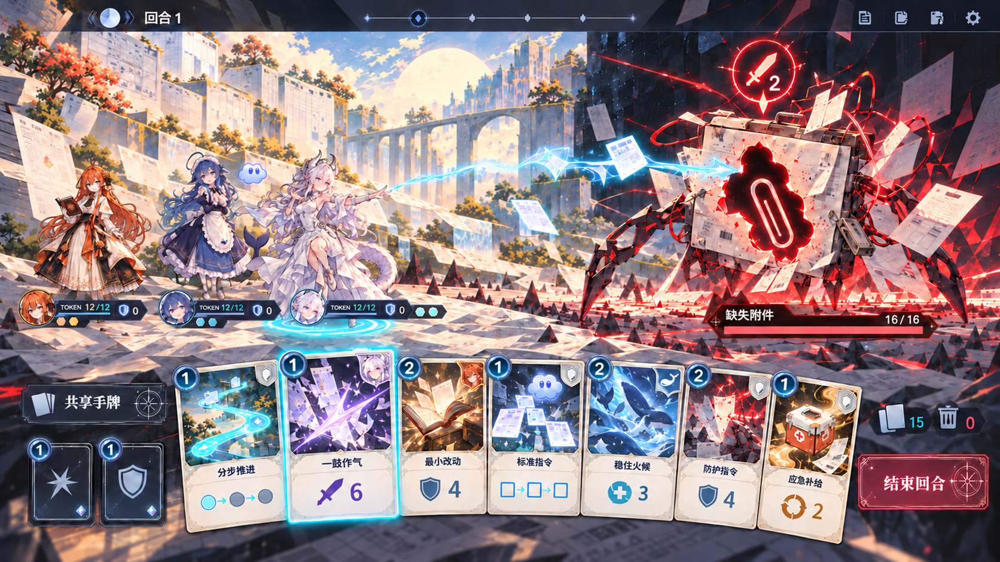

# 《未尽之托》UI 与战斗美术重构方案

版本 v0.2，2026-10-25。本方案先确定战斗界面的信息架构、对手造型语言与首批卡牌插画方向；本轮不修改玩法数值、回合规则和存档结构。



> 阶段 A v2 概念图，以三人队伍和共享混合手牌作为最拥挤的常规布局，用于验证角色尺寸、出牌动作焦点、卡牌归属与目标指向。它不是最终游戏截图；中文、图标和数值在实装时由 Godot 统一排版，现有角色图像仍只作为内部造型参考。生成提示与验收说明见 [v2 配套记录](美术/UI战斗概念图_三人共享手牌_v2_生成提示.md)。较早的 [单角色 v1](美术/UI战斗概念图_GPT对缺失附件_v1.png) 只保留为构图过程记录。

## 一、改造目标

战斗界面从当前“状态面板＋文字按钮”改造成真正的角色对峙场景：AI 同伴站在左侧，对手实体站在右侧，手牌在画面下方展开，意图、生命、token、防护与被动状态直接依附于场中对象。

参考《杀戮尖塔》的不是具体美术，而是三项成熟的信息组织方式：

1. 上半屏是可读的战斗舞台，角色和敌人始终同框。
2. 敌人意图悬在敌人上方，玩家在出牌前就能读懂风险。
3. 下半屏以有插画、有费用、有类型轮廓的卡牌作为主要操作对象。

《未尽之托》自己的辨识度继续来自纸页地形、任务材料、数据残光和“验收压力让世界变形”的设定。对手不是传统怪兽，也不把老师、上司、亲友等现实人物妖魔化；它们是附件、表格、期限和沟通问题形成的任务造物。

## 二、战斗 UI 总览

### 2.1 基准构图

首版继续以当前的 1280 × 720 窗口为基准，采用三层布局：

```text
┌──────────────────────────────────────────────────────────────┐
│ 委托/关卡 · 回合       场景目标/阶段                 暂停设置 │  6%
├──────────────────────────────────────────────────────────────┤
│       敌方攻击指向线                    [意图图标 2× / 4伤害] │
│                                                              │
│  [Claude] [DeepSeek] [GPT→]      特效通道            [缺失附件] │  57%
│  各自 token/盾/被动                                   HP/阶段   │
│        角色脚下状态签片              场景中的任务材料与远景   │
├──────────────────────────────────────────────────────────────┤
│ 共享手牌  基础动作 [通用][GPT][Claude][通用][DeepSeek] 结束回合│  31%
│                混合顺序；用归属签片区分角色牌                │
└──────────────────────────────────────────────────────────────┘
```

- **顶部信息条**只保留委托名、回合、关卡阶段和暂停入口；随机种子移入暂停/调试面板，不再占据主视野。
- **战斗舞台**按常规 2—3 人队伍设计，而不是以单人大立绘为基准。双人前后错位，三人采用浅三角站位；1280 × 720 下待机角色视觉高度约 210—240 px，占画面高度约 29%—33%。
- **行动聚焦**只在出牌瞬间发生：行动者向中间特效通道前移并临时放大到 115%—120%，其他角色保持原位并轻微降亮。动作结束后 0.2—0.35 秒内回到编队，不让任何角色长期占据半屏。
- **角色状态**贴近角色脚下：姓名、token 条、防护图标、已行动签片与专属被动。下线后角色保持在场但变为离散虚线轮廓，避免突然消失。
- **敌方状态**靠近敌人：名称与完整度条位于脚下，意图位于头顶。单体攻击用收束线连向明确角色；多段攻击显示分节刻度；休整显示开放圆环。
- **手牌区**是全队唯一的共享手牌，保持真实抽牌顺序，不按角色拆成多组。通用牌使用纸白中性框；专属牌用角色色归属签片和小型角色徽记区分。悬停上抬并放大，选择后显示“卡牌—行动者—目标”的连续指向线。
- **执行方式**建议从“选牌后再点确认”逐步改为拖拽或“点牌—点目标—松开执行”；设置中保留二次确认开关，兼顾误触与手柄操作。

### 2.2 舞台视觉

普通战与 Boss 战共享一套 UI，仅改变场景和对手：

- 纸页旷野：周报、演示、表格类委托。地面是纸层和网格，远景为单页地标。
- 收件站：邀请、相册、收件人类委托。地面是站台和时间轴，远景为云海、空椅和信箱。
- 战斗开始时环境从明线场景进入“验收态”：纸边折起、网格收紧、错误位置发出珊瑚红警示；角色和手牌区始终由固定中性光照亮。
- 画面发光面积不超过约 15%。敌人可以鲜明，但不能用满屏红色淹没卡牌信息。

### 2.3 角色立绘的首版用法

现有 GPT、Claude、DeepSeek 主图先作为内部原型参考。战斗单位需要透明背景的完整轮廓，但不需要 3D 全模型；推荐使用约六头身的 2D 战斗专用立绘或分层骨骼角色，保证缩到 210—240 px 高时脸部、发型和主要配色仍能辨认。

| 角色 | 站位与动作重点 | 状态反馈 |
| --- | --- | --- |
| GPT | 左前方，身体略朝敌人；右手与小蓝云指向路径 | 连击轨迹分成 0/1/2 段，在角色身后逐段闭合 |
| Claude | 左后方，书本朝内侧，形成稳定的保护姿态 | 暖橙书页护框包住目标；触发反击后书签翻面 |
| DeepSeek | 左前或中位，手势与水纹留出面向敌人的方向 | 1—3 圈低亮水纹显示白饭层数，兑现时向中心收束 |

正式发行前需要重绘统一视角的战斗立绘，并补齐逐图作者与授权记录；现有资产清单明确把这些图像限定为内部造型参考。

### 2.4 信息层级和交互细节

- token 是首要资源：数值、条形和可数刻度同时存在；付费时能量流向卡牌，受伤时粒子从角色向外散失，避免两种扣减看起来相同。
- 防护、连击、反击、白饭都同时使用形状与数字，不能只靠颜色。
- 卡牌不可用时保留插画，但降低饱和度并在费用位置显示具体原因，例如“需保留 1 token”或“本回合已行动”。
- 当前行动角色用脚下光环、状态签片提亮和选中卡的连线三处同步提示；不再额外放一整排“行动角色”按钮。
- 专属牌被选中时自动锁定所属角色；若该角色已行动或下线，牌仍留在共享手牌原位置但降低饱和度并说明原因。
- 通用牌先沿用当前选中的可行动角色。玩家也可先点击场中角色再选通用牌；切换行动者不会改变共享手牌顺序。
- 卡牌归属、行动者和目标是三个独立状态：归属由卡框角标表达，行动者由场中光环表达，目标由连线和落点框表达，不能只用同一种角色色暗示三者。
- 友方目标直接点击场中立绘或状态签片；不再另设“角色目标”按钮行。
- 战斗日志收进可展开侧栏，主画面只浮现最近一次结算，例如“防护吸收 2 / token -1”。

### 2.5 出牌动作系统

不为每张卡单独制作一套完整角色动画，而是把“角色动作类型”和“卡牌专属特效”组合起来。每张卡配置 `motion_tag` 与 `effect_id`；同类牌复用身体动作，差异主要由手势、轨迹、命中特效和音效表达。

| 动作类型 | 角色动作 | 适用卡牌示例 | 特效落点 |
| --- | --- | --- | --- |
| 轻攻击 | 前移半步、手臂或道具向前、快速回位 | 标准指令、校验打击、分步推进、逐条回应 | 角色手部 → 敌人核心 |
| 重攻击 | 蓄力后明显前倾或抬手，动作时间稍长 | 强力指令、一鼓作气、提早开饭 | 多段轨迹汇合 → 敌人 |
| 防护 | 转向目标或展开书页/水纹，身体不必前冲 | 防护指令、最小改动、稳住火候 | 角色手部 → 友方护框 |
| 回复 | 打开补给匣或接住回流粒子 | 应急补给 | 卡牌 → 目标 token 环 |
| 转交 | 行动者与目标同时做短回应动作 | 额度转交 | 两名角色之间的 token 弧线 |
| 基础动作 | 最短的攻击或防御动作，不抢专属牌表现 | 基础攻击、基础防御 | 简洁线性特效 |

单次演出建议控制在 0.75—1.15 秒：选牌与行动者响应 0.15 秒，前摇 0.2—0.35 秒，特效与命中 0.25—0.4 秒，回位 0.15—0.25 秒。连续快速操作时允许 1.5 倍速或跳过回位尾帧，不让动画拖慢卡牌节奏。

三名角色仍要有各自的动作语言：GPT 用指尖和小蓝云绘制分段路径；Claude 以书本、书签和括号护框为动作起点；DeepSeek 通过水纹、鲸尾弧和低火终端完成防护或爆发。同一个“防护”动作类型因此可以共用时序，但不会看起来像换色复制。

## 三、对手立绘设计思路

### 3.1 统一造型语法

所有对手由“现实任务物件＋一个明确故障＋验收压力结构”组成：

- 主体材料：纸张、文件夹、信封、表格框、投影片、站牌、照片、时间轴。
- 敌方形状：尖角、截断线、重复盖章、夹具、套框和拉紧的红线。
- 友方仍使用圆角、弧线和连续轨迹，使敌我只看轮廓也能区分。
- 普通敌人只表现一个问题，轮廓简单；Boss 是多种材料组成的完整交付装置，体积更大、结构更有秩序。
- 受伤不喷血：删去冗余层、解开错误结、校正错位或让空洞逐渐补全。敌人生命越低，问题越清楚，而不是越脏乱。

### 3.2 首批九个对手概念

| 对手 | 核心轮廓与材质 | 待机与攻击预告 | 击败表现 |
| --- | --- | --- | --- |
| 缺失附件 | 一只悬浮的文件匣/信封兽，中央是醒目的附件形空洞，四周有寻找插口的线缆 | 空洞轻微呼吸；攻击时文件夹像夹口合拢，收束线锁定目标 | 空洞被一张素白附件补上，外壳自行归档 |
| 重复条目 | 由相同表格行首尾相接的“复写节虫”，每一节都有相同编号 | 重复节拍逐段亮起；多段攻击按节数依次敲击 | 重复节折叠合并，只留下唯一一行 |
| 口径冲突 | 两个背靠背的量尺/仪表头共用一副机身，左右刻度互不一致 | 两根指针反向拉扯；攻击前交叉成尖锐的 X 形 | 两套刻度对齐成一条共同基准线 |
| 版面溢出 | 页面框架像门，文字块、图表和页签从边缘挤成纸带触手 | 页面边界逐渐收紧；群攻前出现横贯全队的溢出框 | 溢出内容回到网格，页面恢复呼吸空间 |
| 本次提交版 | 巨大的单页折纸装置与盖章机，周报版偏表格塔，演示版偏幕布/投影片 | 页角倒计时、盖章环和分段折叠分别提示招式 | 冗余层一层层脱落，最终成为清楚、可交付的一页 |
| 请确认收件人 | 由信封槽、座位编号、地址连线组成的站务机，胸口保留一个闪烁空位 | 空位依次点名；锁定攻击时红线从地址栏连向角色 | 正确连线点亮，一个空座位稳定出现 |
| 下一站还没填 | 云海站台上的空白翻页站牌，底部轨道通向没有名字的远方 | 站牌高速翻字但总停在空白；攻击时轨道改道 | 站名不被强行填满，而是出现可继续选择的虚线方向 |
| 今天必须交 | 日历、时钟与装订机组成的期限压印装置，像一座不断收紧的办公钟塔 | 秒针切分多段攻击；大招前“今日”印章下压 | 时钟停止催促，日期页被整理为可执行清单 |
| 我 | 不做人形怪物。远景只有一把普通椅子、屏幕光与由离散光点构成的不完整坐姿 | 招式通过未关闭窗口、公开要求与场景规则变化发生；不使用咆哮或巨大肢体 | 战胜后不是消灭“我”，而是让椅子、桌角和屏幕关系变得可辨，座位继续存在 |

### 3.3 对手资产规格

每个对手先制作一张透明背景主立绘，并按“主体 / 前景纸片或粒子 / 地面影子”至少三层拆分。原画建议 1536 × 1536，安全轮廓位于中央 80%，底部统一地平线；游戏内普通敌人显示高约 280—330 px，Boss 高约 360—430 px。

首轮动画不做昂贵逐帧，采用四态切片即可：待机循环、意图蓄势、受击反馈、解构退场。每个对手再加一种独有环境动作，例如附件空洞吸入纸片、重复条目沿网格复制、收件人连线穿过站台。

## 四、卡牌视觉与插画设计思路

### 4.1 卡面结构

首版建议使用约 150 × 210 px 的 5:7 竖卡，悬停放大至约 205 × 287 px：

- 顶部 14%：费用圆章、卡名、升级标记。
- 中部 52%：插画，是玩家扫牌时的第一识别区。
- 下部 24%：一句规则文本，伤害、防护、回复等关键数字放大并配图标。
- 底部 10%：类型、归属与消耗等标签。

卡牌轮廓按类型区分，而不只换颜色：攻击是前倾尖顶，防护是包围式双边框，支援是闭合圆环，转交是双节点连线。通用牌以纸白＋墨蓝为底；GPT 用淡紫蓝分段线，Claude 用橙黑书签，DeepSeek 用深蓝青水纹。角色色只占边框、费用章与少量光效，避免整张卡被染成单色。

插画不采用“一个图标放在渐变背景上”的做法。每张牌至少包含前景动作、中景任务物件、背景方向线三个层次；即使缩小，也应先读出轮廓和动势。通用牌以物件和场景为主，专属牌允许出现角色的手、侧脸或标志性局部，但不重复使用同一张全身立绘。

### 4.2 首批十二张牌的插画母题

| 卡牌 | 插画画面 | 小尺寸识别点 |
| --- | --- | --- |
| 标准指令 | 一条冷青路径从任务单起笔，穿过三个节点命中验收框 | 单一前进箭头＋三节点 |
| 防护指令 | 半透明纸页与括号围成护罩，挡住落下的红色批注 | 包围轮廓＋被挡开的红线 |
| 强力指令 | 多层文件被一枚集中光束/重型指令章贯穿，纸层向两侧翻开 | 粗大纵向冲击线 |
| 应急补给 | 终端车弹出暖色应急匣，token 光点回流到黯淡状态环 | 暖色补给匣＋回流光点 |
| 额度转交 | 两只不同角色特征的手隔着悬浮窗口交接一枚琥珀 token | 两端节点＋中间传递物 |
| 校验打击 | 冷青校验框锁定矛盾项，珊瑚红错误印章从中裂开 | 方框准星＋裂开的错章 |
| 分步推进 | GPT 指尖的小蓝云铺出三块逐次亮起的悬浮踏板，终点是敌方问题核心 | 三段台阶＋蓝云 |
| 一鼓作气 | 已闭合的三段轨迹同时拉直，汇成一束淡紫白冲刺线穿过纸层 | 三线合一的强动势 |
| 最小改动 | Claude 的橙色书签像细针，只缝合页面唯一裂口，周围内容保持原位 | 单一橙色缝线＋完整纸面 |
| 逐条回应 | 编号批注依次悬起，Claude 的括号光刃逐条勾销而非一次炸散 | 1/2/3 条目＋橙色括号 |
| 稳住火候 | DeepSeek 守着低火终端，三圈水纹托住由白色数据粒组成的小饭团 | 低火＋三圈水纹 |
| 提早开饭 | 水纹骤然收束，饭团化为鲸尾弧形冲击波，从桌面切向问题核心 | 鲸尾弧＋向前爆发 |

基础攻击与基础防御不是抽到的牌，建议做成手牌左侧常驻的两枚“小型行动牌”，使用较简洁的线稿插画和不同外框，避免与真正卡组内容混淆。

### 4.3 插画制作规范

- 原始插画建议 1024 × 768 或更高，重要主体位于中央 70%，同时检查 150 × 105 px 缩略裁切是否仍可读。
- 不在插画里生成文字、数字、卡名或 UI；全部文字由 Godot 排版，保证中文清晰并方便数值更新。
- 每张牌保留约 10% 的暗部或空白，供费用章和标题压入，不让人物脸部或关键道具落在裁切边缘。
- 先做灰阶轮廓测试，再上角色色；若去色后攻击、防护、支援无法区分，应修改构图而不是继续加发光。
- 升级版不另画整张图：增加一条清楚的金色校验线、强化关键动作光效，并保留同一主轮廓。

## 五、建议的渐进推进顺序

### 阶段 A：静态战斗垂直切片

先制作 **GPT＋缺失附件** 的单角色构图，再以 **GPT＋Claude＋DeepSeek** 验证最拥挤的三人编队、共享混合手牌和出牌动作焦点。

验收重点：第一眼能看出谁在和谁战斗；三秒内能找到敌方下一招、自己的 token 与当前可用牌；插画不会压过规则数字。

阶段 A 已于 2026-10-25 产出两轮 1672 × 941 概念图。v1 验证单角色对峙、意图和插画卡面；v2 改为三人浅三角编队、全队共享混合手牌、专属牌归属角标，以及 GPT 出牌时短暂前移的动作焦点。v2 是后续 Godot 实装的主要构图参考。

### 阶段 B：接入现有战斗逻辑

重构 Godot 战斗布局，但不改任何数值与规则。优先接入角色站位、敌人意图、完整卡面、场中选目标、最近一次结算浮字和可展开日志。用占位敌人和少量卡图也可以先完成交互。

阶段 B 的交互骨架已于 2026-10-25 接入：支持 1—3 名角色的场中站位与贴身状态、唯一共享手牌、通用/专属归属角标、专属牌自动切换所属角色、点击场中角色选择行动者或友方目标，以及按轻攻击/重攻击/防护/支援/转交分类的短暂位移动作。背景、两类敌人与卡图当前均为明确标注或程序生成的占位资产，未接入来源未确认的角色原图。

### 阶段 C：首批美术资产

按普通敌人“缺失附件”和 Boss“本次提交版”各做一套三层立绘与四态动画；完成 12 张首批卡牌插画；处理 GPT、Claude、DeepSeek 三名角色的原型透明裁切和统一视觉高度。

动作样板子项已于 2026-10-25 完成：GPT 先建立八层 2D 母版和六类统一动作协议，Claude、DeepSeek 通过轻量场景变体复用同一控制器，只覆盖配色、动作幅度与角色母题。当前为程序绘制的可替换占位层，已用于验证拆层、时序与三人同屏尺寸；正式透明分层原画仍未制作。

### 阶段 D：双人/三人与反馈完善

验证双人错位、三人编队、共享手牌中的专属牌合法性、目标连线、下线状态、Claude 保护框和 DeepSeek 白饭层数；补齐轻攻击、重攻击、防护、回复、转交、阶段转换等动作与声音。

### 阶段 E：扩充其余对手与场景

在前两场已经证明布局和资产管线后，再制作重复条目、口径冲突、版面溢出、请确认收件人及三个特殊 Boss，避免一次性生成大量尺寸或视角不适配的立绘。

## 六、下一步建议

阶段 A、阶段 B 与阶段 C 的角色动作样板均已完成。下一轮继续阶段 C：按现有八层接口替换 GPT 的程序占位层为正式透明原画，验收视角、关节和动作幅度后，再沿用同一接口制作 Claude、DeepSeek；随后制作缺失附件、本次提交版和 12 张首批卡图。
