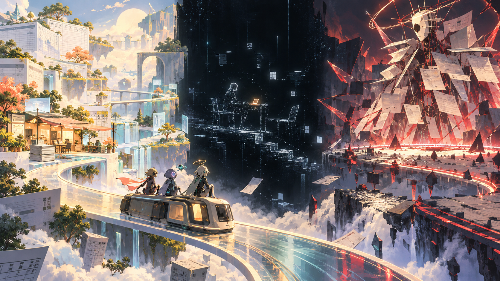

# 《未尽之托》总体视觉风格

版本 v1.0，2026-10-25。本文是场景、角色演出、战斗特效与界面制作的共同美术基准。基础 Demo 只制作大学生、公司员工两种人生阶段，GPT、Claude、DeepSeek 三名可玩角色，以及两章四个任务版本；长期内容沿同一套变化规则扩展。

> 基准图只确定明暗关系、材质方向和三层世界的对比，不锁定最终构图、角色造型或 UI。正式角色继续沿用各自已确认的识别特征。图中不清晰的纸面内容不作为游戏文字。

## 一 视觉定位

一句话：**温暖的任务公路片，藏着一座由数据残光搭成的记忆剧场。**

玩家首先看到的是能生活、能笑、能一起解决问题的科幻旅途；随后才从稀疏、克制的现实片段中意识到，所有奇异景观都来自屏幕另一端某个人的委托。战斗不是突然切到另一套世界，而是任务世界在“验收压力”下发生结构性变形。

总体气质由三部分组成：

| 层级 | 观感 | 主要材质 | 叙事目的 |
| --- | --- | --- | --- |
| 明线旅途 | 明亮、轻快、有生活温度的软科幻 | 纸、磨砂玻璃、哑光金属、全息薄膜 | 让 AI 同伴像真实旅伴，并把任务变成可游览的地方 |
| 暗线片段 | 安静、留白、未完成的数字舞台 | 光点、短线、01 字形碎片、扫描残影 | 用最少动作与语言还原“我”的生活证据 |
| 战斗验收 | 清晰、紧张、由对手改写环境 | 任务材料、警示几何、折叠空间、粒子断裂 | 让敌人机制在场景里可见，同时保持出牌信息清楚 |

三层不是三种互不相干的画风。它们共享相同的轮廓语言、角色比例和基础色，只改变“世界完整度”：明线完整，战斗被重组，暗线只剩必要信息。

## 二 共同视觉语法

### 2.1 形状

- 友方、道路与可交互物以圆角、弧线、连续轨迹为主，表现协作与推进。
- 敌方压力以尖角、截断线、套框和重复盖章形状为主，表现要求、期限与验收。
- 不可确认的信息使用虚线轮廓或缺口，不用模糊滤镜冒充悬念。
- AI 的数据感来自局部精确结构，不把所有物体都铺成高密度电路纹。

### 2.2 材质

任务世界的核心材质是“现实办公物被系统重新解释”：纸张能成为地形，表格网线能成为道路，批注能成为路标，附件能成为车厢或站台。科技感用磨砂玻璃、悬浮卡槽、微弱发光接缝和分层视差表达，避免常见的霓虹都市、满屏代码和金属管线。

### 2.3 基础色板

| 用途 | 色值 | 说明 |
| --- | --- | --- |
| 墨蓝黑 | `#0A101B` | 夜景、暗线底色、深层 UI |
| 纸面白 | `#F2EFE7` | 明线主体、卡牌与可读区域，不使用纯白大面积刺眼底 |
| 冷青 | `#69D7E7` | 系统反馈、可交互信息、暗线光点 |
| 暖琥珀 | `#F2B85B` | 旅途灯光、已确认信息、人与人留下的温度 |
| 珊瑚红 | `#EF6A62` | 紧急、伤害、冲突项；必须同时配合形状和动效 |
| 薄荷绿 | `#75C9A7` | 恢复、完成、可继续推进 |
| 失活灰 | `#697386` | 下线、不可用与历史记录 |

屏幕同一区域最多出现一个任务主色、一个角色强调色和一个系统状态色。发光面积原则上不超过画面的 15%，暗线除外。

### 2.4 光线

- 明线使用大面积柔光与清楚的昼夜方向，阴影保留一点蓝灰色，不做糖果色泛光。
- 暗线几乎没有环境光，只由需要叙事的角色、物件和一句文字发光。
- 战斗光线随敌人改变，但角色面部与卡牌区始终由固定的中性补光保持可读。

## 三 明线：会随任务生长的公路世界

### 3.1 固定骨架

明线的固定场所是“行旅终端”：一辆小型终端车、一条可向任意任务延伸的透明道路，以及若干休息站。车辆不是写实汽车，更像纸张收纳盒、服务器机箱与观景车厢的组合。车内保留三处可识别位置：任务打印口、队伍座位、展示当前材料的悬浮窗。

每次接单采用同一变形流程：

1. 终端吐出任务单，只显示目标、已知材料和验收重点。
2. 任务单上的网格或排版线向远处延伸成道路。
3. 道路两侧先长出任务的基础几何，再加载人生阶段和在队角色的局部变化。
4. Boss 前，远景中的交付物轮廓第一次完整出现，玩家提前知道本章在“做成什么”。

### 3.2 三层变化优先级

场景按照“任务 60%＋人生阶段 25%＋队伍 15%”组合，优先保证任务可辨认。

| 变量 | 可以改变 | 不应改变 |
| --- | --- | --- |
| 当前任务 | 地形骨架、主道具、远景地标、环境主色、Boss 外壳 | 基础 UI、角色比例、交互颜色含义 |
| 人生阶段 | 材料磨损、空间尺度、旁观物、时间段、现实物件 | 将阶段做成高低贵贱、改变角色尊重态度 |
| 已选角色与队伍 | 15%以内的强调色、车内私人物、环境反馈粒子、互动动作 | 用角色色覆盖整个场景、让未入队角色出现 |
| 当前最终任务 | 终点地标、远景天气、道路收束方向、章节标题材质 | 中途突然泄露暗线结论或隐藏“我”身份 |

人生阶段与任务是正交组合。例如“把本周做成一页”在大学生阶段可出现教室窗影、便利贴和午后阳光；公司员工阶段可出现会议室玻璃倒影、工位灯和夜色。二者仍共享“表格梯田＋单页地标”的任务骨架，避免重复制作完整场景。

### 3.3 基础 Demo 两套场景包

#### A. 纸页旷野

服务第一章“把本周做成一页”和“最后一页”。地面由纸层、表格网线和折叠页角组成，远处是一座只有一页厚度的白色地标。道路经过缺失附件形成的断桥、重复条目形成的回环坡道和口径冲突形成的双轨。

- 周报变体：横向网格、数据梯田、被风掀起的批注旗。
- 演示变体：纵向画幅、幕布山体、图表光束与逐层展开的舞台。
- 学生覆盖层：手写便签、课桌纹理、窗外日光、较轻的使用痕迹。
- 员工覆盖层：文件标签、玻璃隔断、冷暖混合夜灯、清楚但不过度压抑的时间提示。

#### B. 收件站

服务第二章“请留一个座位”和“把那一天找回来”。基础空间是建在云海边缘的候车站，轨道由收件人连线与照片时间轴组成。空椅、未点亮的站牌和封闭的信箱共同表达“有人在等”，但不预判结局。

- 邀请变体：长桌式站台、成排但不完全相同的座位、两块互相冲突的日期牌。
- 相册变体：潮汐般开合的照片层、半透明底片桥、无法确认日期的空框。
- 成功后不把世界变成满屏烟花，只让正确路径连上、一个座位点亮或一张照片稳定下来。
- 失败后不做世界毁灭，只保留具体缺口，例如空收件栏、断开的日期线或缺少来源的画框。

### 3.4 角色如何提醒玩家“她们是 AI”

角色仍然是有温度的少女形象，不改成机器人。每人稳定保留四种轻量数字特征：

- 虹膜内有一圈低亮度对焦环，只在处理材料或锁定目标时转动。
- 服装或饰品有一条极细的状态光缝，颜色属于角色，亮度属于状态。
- 快速移动后留下 2—3 帧离散残像，残像由短线和微小数据点组成。
- 投影、镜面或阴影比本人慢半拍完成动作，安静提醒她们并非人类。

日常演出每个镜头只启用其中一种，避免人物一直闪烁。触摸纸张、坐车、吃饭和整理衣角等动作必须保留真实重量；科技感不能消除生活感。

### 3.5 首发角色环境签名

| 角色 | 强调色与形状 | 场景反馈 | 禁止做法 |
| --- | --- | --- | --- |
| GPT | 珍珠白、淡紫、柔和蓝；分段线与小型环 | 路径被拆成清楚的三段，指尖小蓝云投出临时路标 | 用整屏蓝色代码表现“聪明” |
| Claude | 橙、黑、米白；括号、书签和保护框 | 关键物被细线框定，危险前出现一层暖色护页 | 把警告做成不停弹窗或让她永远站在队伍背后 |
| DeepSeek | 深蓝、青、白；水波、鲸尾弧和简化节点 | 冗余路径折叠成短路，蓄力时有三圈低亮度水纹 | 大量食物梗遮住任务信息，或将女仆造型等同服从 |

后续角色也按“一个强调色族＋一种基础形＋一种环境反馈”扩写，不给每人另造一套世界渲染管线。

## 四 暗线：离散记忆剧场

暗线借用“人物与场景由光点或 01 字形碎片拼起”的表现原则，形成原创的**离散记忆剧场**。只吸收离散构成、黑场留白和克制动作，不沿用任何现有作品的角色轮廓、界面、镜头或特效造型。

### 4.1 构成规则

- 底色接近纯黑，画面只生成本段必须存在的人、桌面、屏幕、椅子和一个关键物件。
- 人物不展示完整面孔。前期以手、肩部、坐姿和屏幕反光为主；信息足够时才增加侧脸轮廓。
- 稳定事实由连续光点组成，推测由间断点线组成，错误或被否定的信息会解体成无方向碎片。
- 01 字形只占粒子的少数，且小到先被看成材质、靠近后才可辨认；禁止做代码瀑布背景。
- 每个片段只保留一个暖色物件，例如凉掉的饭盒、未发送按钮、空座位或一张照片，用作人的生活锚点。

### 4.2 镜头与动作

单段建议 8—18 秒、最多三个镜头、一个主要动作和一个反应动作。可用动作库：

- 光标停住，删掉一句话，再输入更短的一句。
- 手把文件拖入发送区，停顿后松开。
- 椅子向空位挪开一点，又停住。
- 合上饭盒，屏幕上的完成提示才亮起。
- 翻到照片背面，指尖停在没有日期的位置。
- 关掉一个窗口，桌面上仍留着另一个未处理的窗口。

动作不使用大哭、跪倒、砸桌等强迫玩家感动的演法。情绪由停顿、重复和物件位置表达。

### 4.3 语言上限

一段暗线以无对白为默认，最多两句清晰短句；单句建议不超过 14 个汉字。句子只陈述当下能被证实的行动或反馈，不解释主题。

示例：

> “收到，我补上来源。”
>
> “你是不是忘了我？”

> “那天不是这样的。”
>
> “我先标成不确定。”

同一信息不同时出现在旁白、字幕和物件文字中。重要事实进入收藏卡片，暗线演出本身保持简洁。

### 4.4 胜败与进度差异

- 成功片段：关键人物与物件从散点逐渐连成稳定轮廓，但画面仍不完全实体化。
- 准备阶段失败：场景只生成到一半，缺失材料的位置保留为明确空洞。
- Boss 验收失败：交付物已经完整出现，随后只有具体错误部分解体，不能把“我”整个人粉碎。
- 随收藏增加，场景不是简单越来越亮，而是让同一个房间的空间关系更清楚，玩家开始认出重复出现的桌角、窗、联系人和时间。

## 五 战斗：任务世界进入验收态

### 5.1 固定可读层

战斗沿用明线场景和角色，不切换成纯抽象黑房。所有战场保留三条固定层级：

1. 前景为卡牌与角色状态，受固定中性光保护。
2. 中景为角色和敌人，轮廓不能被粒子、字幕或场景道具遮挡。
3. 后景表现对手与任务变化，只在意图预告和阶段转换时提高亮度。

敌人所有攻击预告同时具备颜色、形状、方向和节奏四种线索。单体攻击用收束线指向明确槽位；多段攻击用分节刻度；群体攻击用横贯全队的宽框；休整用开放圆环和降低的环境脉冲。不能只用红绿区分。

### 5.2 对手驱动的变化

每个对手获得一套“战场签名”，只需四项即可形成区别：

| 项目 | 含义 | 示例 |
| --- | --- | --- |
| 地形动作 | 场景怎样受压 | 页面折叠、轨道改道、座位锁定、照片退潮 |
| 敌人轮廓 | 任务问题怎样成为形体 | 附件空洞、重复数据群、验收框、收件人节点 |
| 预告形状 | 玩家如何读招 | 盖章、括号、倒计时页角、断裂时间轴 |
| 声画节拍 | 攻击的情绪 | 打字节拍、翻页、投影机切换、快门与列车提示音 |

普通敌人优先表现单一问题，轮廓简单、动作短。Boss 是完整交付物与验收条件的组合体，体积更大但结构更有秩序，不把现实里的老师、上级或朋友画成怪物。

### 5.3 Demo Boss 视觉变体

- **本次提交版**：一座不断折叠、盖章又展开的单页装置。周报版本以表格网与数据块为外壳；演示版本以幕布、投影片和依据页为外壳。受到伤害时删去冗余层，生命降低反而更清楚。
- **请确认收件人**：一座由信封槽、座位编号与时间线组成的站务机。邀请版本缺一个不断闪烁的收件位；相册版本则有一段无法对齐的日期轨道。
- **隐藏“我”**：不用巨大人形。远景中离散记忆剧场与明线战场短暂重叠，一个由光点组成的普通座位出现在终点。“我”的招式通过公开要求改变场景规则，战胜后座位保持存在，不演成消灭对方。

### 5.4 角色机制的视觉反馈

- GPT 连击：连续轨迹逐段闭合，0、1、2 层用路径段数表示；中断时自然熄灭，不爆碎。
- Claude 保护与反击：目标外出现一层薄书页式护框，实际挡伤后书签翻转为反击标记。
- DeepSeek 白饭：脚边或角色侧方出现一到三圈水纹式状态环；提前兑现时向中心收束，满层攻击时向外释放。卡面仍显示数字，不能只靠装饰判断层数。
- token：表现为个人状态条与可数刻度，不把生命和费用分别画成两套相似资源。扣费与承伤采用不同动效方向，前者向卡牌流动，后者向外散失。

## 六 界面、字体与图标

界面像“旅途中不断被整理的工作台”，不是透明蓝色 HUD 大合集。

- 常规界面：纸面白卡片叠在低透明磨砂玻璃上，圆角 8—12 像素，细线分区，阴影短而软。
- 战斗界面：角色状态固定在对应槽位，敌人意图始终高于装饰层；手牌区不受场景色污染。
- 暗线界面：隐藏大部分常规 UI，只保留字幕、跳过提示与必要的收藏确认。
- 收藏界面：像被整理好的证据盒，按人生阶段、任务和结果筛选；互斥人生明确标成不同可能，不做一条假时间线。
- 字体建议采用一套清晰的人文无衬线体作为正文，一套等宽数字体只用于 token、版本号、01 碎片与系统状态。正文不要通篇等宽。

图标必须同时靠轮廓区分：攻击用向前断面的尖形，防护用包围轮廓，恢复用闭合回路，已行动用落下的签片，下线用断开的连接点。低分辨率下先保住外形，再保住纹理。

2026-10-27 地图专用补充：路线选择页采用低饱和灰纸任务图，使用自下向上的细虚线路径、小型单色事件符号与手绘式可选圈。科幻感只放在页边刻度、稀疏终端连线与玩家身份纹样；地图差分由大学生、研究员等玩家人生身份决定，轻微改变纸色与页边的课表、实验记录等元素，不改变路线位置、符号含义或节点可用条件。AI 小队构成不影响地图配色或纹样。此处是地图界面的专项规则；明线场景的队伍反馈规则仍适用于场景演出。地图不使用明线风景原画作为底图。现行地图规格、八类矢量符号与实机证据见 [地图路线与事件符号 v2](美术/地图路线与事件符号_v2.md)。

## 七 镜头、动画与转场

- 明线探索以平稳横移、车窗视差和小幅推镜为主，营造同行感；每次任务切换只做一次明显的道路生成演出。
- 对话镜头优先双人或多人同框，用眼神、道具递接和座位关系表现协作，避免每句都切大头立绘。
- 战斗镜头不因普通攻击大幅摇晃。Boss 阶段转换可以短暂改变构图，但必须在玩家恢复操作前回到标准机位。
- 明线进入暗线：画面中的一个发光物件保留，其他颜色与实体逐层撤去，最后只剩光点舞台。
- 暗线返回明线：不做故障式闪屏；由同一个物件重新长出纸面、道路和环境声，使两条线确实属于同一世界。

建议角色日常动画采用 12—18 帧的清楚动作关键帧，粒子与 UI 保持更平滑刷新。数据感来自两种时间采样的轻微错位，而非频繁抖动。

## 八 声画联动方向

虽然本文以视觉为主，以下声音规则用于防止后续视听冲突：

- 明线底层是轻快的旅行节奏，任务材质提供打字、翻页、提示音等打击乐。
- 暗线保留房间底噪、一次按键或椅子摩擦；音乐可以只剩一个持续音，不用煽情弦乐解释情绪。
- 战斗按敌人加入一层节拍，不完全换曲；意图预告的声音长度与分段数一致，帮助读取多段伤害。
- 角色状态音使用各自材质：GPT 是柔和路径闭合声，Claude 是纸页与书签声，DeepSeek 是低亮度水滴与瓷碗声。

## 九 标题画面与章节包装

标题画面使用尚未完全生成的道路：终端车停在近景，远处由纸页、光点和云层共同形成空白终点。标题《未尽之托》像一张被打印到一半又继续向前延伸的任务单，“未尽”保留一处可见缺口，“托”字落在稳定的暖光里。标题动画应安静完成，不使用黑客入侵、代码瀑布或故障警报。

章节开始以一张任务票据包装：左侧是任务名，中部是三项验收重点，右侧是人生阶段与本局队伍的小型印记。最终任务票据比普通任务多一条通向远景的实线，但不提前写明结局。

## 十 可访问性与性能边界

- 状态不能只靠色相表达；颜色、图形、位置和文字至少同时使用两种。
- 发光文字与粒子背后必须有低透明深色衬底或足够留白，1080p 下正文字号不低于界面基准。
- 提供降低粒子、关闭闪烁、减弱屏幕震动和跳过暗线演出的选项。暗线跳过不影响收藏保存。
- 大量光点优先使用 GPU 粒子或预烘焙序列；低配模式保留主体轮廓点，先减少漂浮碎片与远景层。
- 每个场景只保留一个高密度视觉焦点。卡牌展开时，场景发光和粒子自动降到 60% 左右。

## 十一 基础 Demo 制作清单

### 11.1 必做

- 一套行旅终端与道路骨架，含接单、行驶、休息三种状态。
- 纸页旷野、收件站两套基础场景，各有两个任务装饰变体和学生/员工两套覆盖层。
- “本次提交版”“请确认收件人”两种 Boss 骨架，各支持两个任务外壳。
- GPT、Claude、DeepSeek 三人的状态光、环境签名和机制反馈。
- 一套离散记忆剧场，至少支持桌面、屏幕、椅子、饭盒、座位、照片六类关键物件。
- 完整的非颜色战斗意图图形和 token、行动、下线状态图标。
- 明线到暗线、明线到战斗、战斗回明线三种转场。

### 11.2 可后做

- 大量表情差分、远景 NPC、复杂车辆内部、六人生阶段全部覆盖层。
- 每个任务一套完全独立战场、角色专属胜利动画、全角色暗线插画。
- GPT 两条进化形态、DeepSeek 双形态及其他长期角色的场景签名。

裁剪时先减粒子密度、远景层数与表情数量，不能裁掉敌人意图、AI 身份提示、暗线关键物件或任务区别。

## 十二 首轮验收标准

- 去掉文字后，测试者仍能分辨明线旅途、暗线片段和战斗验收三种状态。
- 静止截图中至少能看出一项“她们是 AI”的非文字线索，但人物仍有日常生活感。
- 同一任务换人生阶段时，有三处局部差异；换在队角色时，有一处环境反馈和一处角色状态差异；任务主体不被覆盖。
- 四个 Demo 任务只看远景地标和主要道具即可区分，不依赖任务标题。
- 暗线关闭声音后仍能从一个动作、一个关键物件和最多两句短句理解发生了什么。
- 战斗特效最高亮度时，敌人意图、目标、token、行动状态和卡牌费用仍清楚可读。
- 色觉异常模拟与低饱和度截图中，攻击、防护、恢复、不可用和下线仍能区分。
- 隐藏“我”的胜负演出不会被理解为杀死现实人物，而是结束一次无法停止的验收。

## 十三 制作禁区

- 不使用“全屏蓝色代码＋霓虹城市”作为通用 AI 速记。
- 不让暗线每次都走向悲惨，也不以人物崩溃替代具体事件。
- 不把老师、上级、朋友或“我”直接怪物化；敌人是问题、要求和交付结构。
- 不因角色配色鲜明就让场景跟随角色整体换皮。
- 不用镜头抖动、故障闪烁和粒子爆炸遮掩缺少动作设计。
- 不直接复制参考作品的角色、UI、光点轮廓、镜头与技能特效。

这套风格的最终判断标准不是“看起来有多像 AI”，而是：玩家能否在一个温暖、清楚、可行动的世界里与 AI 同伴一起完成任务，同时从越来越少、越来越准的现实画面中看见任务之外的人。
