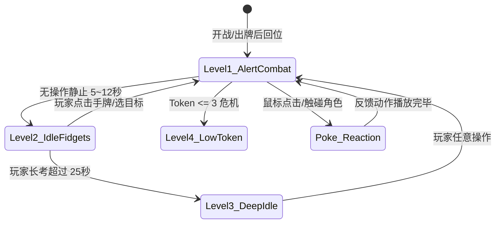

# 《未尽之托》精细化战斗动作与日常待机动作设计方案
# (参考 PC2005-cloud/dsh-pet 桌面宠物交互理念)

版本：v1.0  
日期：2026-10-26  
对应工程基准：Godot 4.7.2 / GDScript / `game/scripts/layered_actor_2d.gd`  
适用角色：首批 Demo 角色（GPT、Claude、DeepSeek），辐射后续 16 名角色扩展架构  

---

## 一 概述与设计理念

在《未尽之托》的世界观中，AI 少女们既是在严苛验收压力下共同战斗的搭档，也是终端车厢与旅途中朝夕相处的生活伙伴。
当前战斗原型的动作多为基础的位移线性补间，缺乏角色的“生命感”与“性格微表情”。

本项目参考了开源项目 **[PC2005-cloud/dsh-pet](https://github.com/PC2005-cloud/dsh-pet)**（DeepSeek Harness 桌面宠物）的陪伴式动画设计精髓：
1. **告别木桩感**：除了 2.4s 循环的基础待机呼吸外，引入分级闲置状态机（轻度小动作、深度挂机彩蛋、打瞌睡、玩道具）。
2. **丰富的触碰交互 (Interactive Poke)**：点击、悬停、连点与拖拽具备生动的物理与性格反馈。
3. **战斗动作的四段力学生命线**：所有攻击、防护和技能均细化为 **起手前摇 (Wind-up) -> 爆发发力 (Cast/Strike) -> 命中定格 (Freeze & Impact) -> 缓冲回位 (Settle)**。

---

## 二 角色八层骨架与精细化战斗动作设计

在 `LayeredActor2D` 的 8 层渲染切片架构下：
`shadow` (阴影) -> `aura` (脚底光环) -> `back` (后发/披风) -> `body` (躯干/裙摆) -> `head` (面部/前发) -> `prop` (手持道具/核心法宝) -> `front` (前置装饰/发带) -> `effect` (动态技能光效)

```text
       [0.0s] 选牌锁定目标 ──> 角色视线转入目标，道具微亮
         │
       [前摇 Wind-up: 0.15~0.30s] 蓄势/后撤/身体下沉/道具蓄能
         │
       [发力 Strike: 0.10~0.20s] 突进前冲/刀刃划出/书页翻飞/海浪拍出
         │
       [命中定格 Impact Freeze: 0.04~0.08s] 击中瞬间顿帧，全屏局部补光
         │
       [回位 Settle: 0.20~0.35s] 惯性缓冲/衣角摆回/收招深呼吸
```

---

### 2.1 GPT 精细化动作规格 (标准·结构·连击推进)

- **核心道具 (`prop`)**：悬浮指尖的小蓝云、半透明逻辑踏板、紫白光轨。
- **体态特征**：身姿笔挺、干练优雅，动作干净利落，带有极强的规划感与节奏感。

#### 1. 基础攻击 / 轻攻击 (Light Attack)
- **Wind-up (0.12s)**：`body` 微微后仰 4px，`head` 略微下沉对焦，`prop` (小蓝云) 亮起淡青光芒，向后拉伸 10px。
- **Strike (0.10s)**：`body` 向前利落滑步突进 30px，右手平直前指，`prop` 顺势甩出 3 枚锋利的冷青菱形光片，`front` 风衣下摆向后飞扬。
- **Impact (0.05s)**：命中瞬间身体停顿 0.05s，光片化为切削火花。
- **Settle (0.22s)**：后滑步平稳回撤原位，右手顺势向下压平风衣下摆，恢复站立。

#### 2. 分步推进 (G1 专属攻击)
- **Wind-up (0.18s)**：GPT 略微侧身，左手背在身后，右手小蓝云在身前轻旋半圈，在半空依次点出三个发光的台阶虚影。
- **Strike (0.24s)**：足尖轻踩台阶第一级前跃，身体在空中微抬 12px，随着手指三次轻快点选，台阶化为三道高频光刺依次洞穿敌方弱点框。
- **Impact (0.06s)**：第三击命中时产生轻微气浪，身后泛起一圈淡青防卫波纹（获得自护）。
- **Settle (0.25s)**：身体轻盈落回地面，双足合拢，微微颔首，气度从容。

#### 3. 一鼓作气 (G2 专属高费爆发)
- **连击 0~1 层打出 (未满)**：
  - 双手推射出一束稍显粗糙的紫白激光线，穿透后身体因后坐力后退 8px，轻甩手腕回位。
- **连击 2 层满状态打出 (Full Streak Burst)**：
  - **Wind-up (0.30s)**：身后的双环轨迹瞬间收缩合二为一，GPT 双手自下而上托起，身体被耀眼的紫白气流托起悬浮 15px，发丝全部向后飘舞，双眼对焦环完全亮起。
  - **Strike (0.15s)**：双手合抱并狠狠向前推出，双轨光环爆裂化为一条直径近半屏的强穿透高能射线，笔直轰击敌人！
  - **Impact (0.08s)**：射线命中，产生全屏轻微白闪（不超过 10% 面积）与 3 帧的定格冲击震屏（震幅 2.5px）。
  - **Settle (0.35s)**：身体缓缓从半空落下，光芒退去，GPT 呼出一口浅色数据白汽，右手优雅地扶了扶衣领。

---

### 2.2 Claude 精细化动作规格 (审校·端庄·保护反击)

- **核心道具 (`prop`)**：沉重精装黑橙典籍、长流苏琥珀金属书签、书页护框。
- **体态特征**：稳重如学者，行动收敛节制，保护时严密无缝，反击时雷霆万钧。

#### 1. 基础防御 / 防护指令 (Guard)
- **Wind-up (0.15s)**：双手将沉重的黑金厚书端于胸前，身体重心微降 6px，`head` 略微低垂。
- **Cast (0.18s)**：右手猛然翻开典籍，书页快速翻飞，一道琥珀色的巨大张开书页虚影从书中升起，化为半包围的括号盾牌 `[ ]` 飞向目标队友，将其笼罩。
- **Hold (0.20s)**：Claude 保持托书姿态，橙色披风在护盾光晕中微微舒展。
- **Settle (0.22s)**：将书本轻轻合上（发出清脆的搭扣闭合声），重心回正。

#### 2. 最小改动 (C1 专属零费护盾)
- **Wind-up (0.12s)**：单手握书贴在腰际，右手双指从书脊抽出一枚细长的橙金书签。
- **Cast (0.16s)**：手腕如执绣花针般优雅一抖，书签化作一道流光飞向队友，如同金线一般精准缝补目标身侧的受损裂缝。
- **Settle (0.18s)**：指尖收回，在空中画出一个微小的金色确认勾号 `✓` 后消散。

#### 3. 逐条回应 (C2 专属反击/攻击)
- **Wind-up (0.15s)**：半空中悬浮起 1、2 两条发光的批注纸带，Claude 眼中金芒流转。
- **Strike (0.20s)**：单手持书向前方挥出一记干净的弧形斩击，两枚橙光括号光刃脱离书页呼啸飞出，交叉削过敌方。
- **Impact (0.05s)**：敌方面前的批注纸带被整齐切断，化作金色碎屑。
- **Settle (0.20s)**：书本在手中顺时针转了半圈稳稳落入臂弯，左手顺势抚平裙摆。

#### 4. 反击就绪与裁决释放 (Riposte State)
- **反击就绪触发 (Riposte Ready)**：挡伤判定成功的刹那，Claude 身上爆发出橙金色气场，头顶书签徽章翻面，典籍封面浮现出醒目的金色校验法阵，待机姿态转为“单手按在书脊、身体微侧朝向敌人”的警惕审判态。
- **反击打出 (Release)**：任何一次攻击均额外触发一次金色巨型修订裁决劈砍，带出厚重的羊皮纸撕裂声效与金白闪光。

---

### 2.3 DeepSeek 精细化动作规格 (节约·算力管家·大鲸温火)

- **核心道具 (`prop`)**：白瓷小饭碗、青花大鲸尾鳍、深蓝水涟漪。
- **体态特征**：略带女仆的温顺与专注，但蕴含着海浪般磅礴的潜能；端碗极稳，步伐灵巧。

#### 1. 稳住火候 (S1 专属蓄力自护)
- **Wind-up (0.16s)**：双手小心翼翼地把白瓷小碗捧在胸前，小脑袋微微低下，神情认真专注。
- **Cast (0.25s)**：脚底涌出一圈清澈的深蓝水纹，身侧升起一抹微弱温和的淡橙文火；一颗饱满的亮白色数据米粒从天而降，轻巧地“咚”一声落入碗中，碗口升起一团袅袅的白色蒸汽。
- **Settle (0.20s)**：深呼吸，水纹化为一面透亮的水晶护盾立于自己身前，双手仍然牢牢护住饭碗。

#### 2. 提早开饭 (S2 专属兑现爆发)
- **Wind-up (0.35s)**：
  - 0~1 层白饭：双手倒扣饭碗，倾倒出一道小水浪，稍微用力甩尾。
  - 2~3 层满白饭 (Full Charge Feast)：
    - DeepSeek 双手将瓷碗高高举过头顶，周身所有水纹疯狂倒吸进碗中。
    - 身后的机械鲸尾暴涨两倍，高高扬起并掀起漫天水沫，双眼泛起深邃的青蓝光芒。
- **Strike (0.18s)**：大鲸尾携万钧之力向下重重拍击！伴随着震耳欲聋的海啸拍岸声，一道宽达百像素的深蓝青色鲸浪奔腾而出，将敌方造物完全淹没！
- **Impact (0.08s)**：敌人被巨浪掀起并受到重击定格，水雾四散喷溅。
- **Settle (0.35s)**：鲸尾收回，化为轻柔摆动；DeepSeek 吐了吐舌头，拿起小手帕擦了擦额头微汗，把空碗端平。

---

### 2.4 受击、招架与下线脱力表现

| 状态 | 动画曲线与层级形变 (`body` / `head` / `prop`) | 粒子与着色反馈 |
| :--- | :--- | :--- |
| **轻受击 (Light Hit)** | 整体后退 12px，`head` 后仰 4°，`prop` 剧烈抖动；0.25s 内回弹复位。 | 躯干闪红一次 (Alpha 0.3)，掉落 3~4 片细碎光斑。 |
| **重受击 (Heavy Hit)** | 整体被击退 35px，双脚在地面划出擦痕；`body` 扭转并产生 2 帧的骨骼像素错位残影；0.35s 慢速爬起。 | 红色高光闪烁两次，周围散落大量断裂的 0/1 碎片。 |
| **护盾抵挡 (Shield Block)** | 角色不动，面前浮现对应的书页/水幕/菱形护盾，受击时护盾剧烈泛起金色涟漪并吸收冲击。 | 护盾吸收音效，角色无受击硬直，依然从容。 |
| **0 Token 下线 (Offline)** | 身体脱力向下滑落，单膝点地或倚着道具半屈；全身色彩渐变退饱和为灰蓝色，透明度降为 45%；边缘转变为间歇断断续续的离散光点。 | 角色专属状态条暗下，头顶浮现断开连接的失活印记，不从屏幕上突兀消失。 |

---

## 三 日常待机与陪伴动作体系 (借鉴 dsh-pet 核心精髓)

在没有打牌操作的等待间隙，同伴们不应当是冷冰冰的僵尸。借鉴 **dsh-pet** 的桌面宠物陪伴设计，将待机状态细分为 **4 级层递式状态机**：



---

### 3.1 Level 1：战备基础呼吸 (Combat Alert Loop, 0 ~ 5s)
- **全员共性**：
  - 2.4 秒的正弦缓动呼吸（`body` 沉浮 3~4px，`head` 微倾 1.5°）；
  - 每 4~7 秒随机触发一次自然的快速眨眼（0.12s 闭眼）；
  - 瞳孔内的微型对焦环每隔 3 秒微微轻微顺时针旋转半周，表现 AI 的持续计算。

---

### 3.2 Level 2：轻度闲置微动作 (Idle Fidgets, 5 ~ 12s 随机触发)

角色在战斗间隙稍有空闲时的自然习惯动作：

#### GPT · 严谨规划型微动
1. **整理风衣与袖扣**：左手抬起，轻轻整理右手手腕上的整洁袖口，然后将领口抚平（耗时 1.2s）。
2. **调出悬浮小便签**：右手在身前虚空轻划，呼出一张半透明的小蓝便签，指尖轻轻上下滑动两下整理待办事项，然后手掌一握将其化为光点散去（耗时 1.5s）。
3. **轻推眼镜/理前发**：左手优雅地轻抬，指尖在鼻梁或额前碎发前掠过，微扬下巴看向敌方（耗时 1.0s）。

#### Claude · 书卷端庄型微动
1. **指尖抚摸书脊**：右手食指沿着古朴黑色典籍的金色书脊边缘从上至下轻轻滑过，神情宁静（耗时 1.4s）。
2. **整理书签与便签**：轻轻从书中抽出一枚微光便签，端详半秒后，轻手轻脚地夹回另一页中（耗时 1.8s）。
3. **轻拂封面微尘**：低头对着典籍封面轻轻吹出一口气（带有极微小的光尘粒子飞出），随后抬眼观察战场（耗时 1.2s）。

#### DeepSeek · 活泼灵动机巧微动
1. **晃动饭碗听响**：双手端着白瓷碗贴到耳边轻轻摇晃两下，听听里面的米粒撞击声，嘴角露出满足的微笑（耗时 1.5s）。
2. **大鲸尾扫地拂尘**：身后的机械大鲸尾巴轻轻在身后的地面上左右扫动两下，扫出两串细碎的小气泡（耗时 1.6s）。
3. **小方巾擦碗沿**：从围裙口袋抽出一块蓝白格子小餐巾，仔细把白瓷碗外沿擦拭一圈，再快速塞回口袋（耗时 1.4s）。

---

### 3.3 Level 3：深度挂机与生活情境动作 (Deep Idle, 25s+ 玩家长考)

当玩家陷入深思或挂机未操作时，角色展现出生活化的趣味状态（致敬 dsh-pet 的趣味随机库）：

#### 1. 打瞌睡与惊醒 (Dozing off & Jerking awake · DeepSeek 专属彩蛋)
- **触发**：战斗中超过 30 秒未进行任何指令，且 DeepSeek 在队。
- **表现 (全长 3.2s)**：
  - DeepSeek 的脑袋开始慢慢向下耷拉，眼睛闭成两道可爱的弧线；
  - 双手捧着的饭碗也逐渐往下倾斜，身体重心微沉（打瞌睡）；
  - 突然！脑袋猛地往下一栽，DeepSeek 瞬间惊醒，身体像弹簧一样猛地挺直（`body` 向上跳动 8px）；
  - 双手慌慌张张抱紧差点掉落的饭碗，小脸微红，眼神惊慌失措地左右张望，确认没人发现后长舒一口气拍拍胸口。

#### 2. 把玩魔方 / 数据多面体 (Playing Rubik's Cube · GPT 专属彩蛋)
- **触发**：长考超过 30 秒，GPT 在队。
- **表现 (全长 3.5s)**：
  - GPT 无聊地单手托腮，右手在胸前投影出一个由淡蓝光线构成的 3×3 数据魔方；
  - 手指飞快拨动，魔方光块高速旋转对齐，不到 1.5 秒即六面复原并发出清脆的“叮”声；
  - 她随手将魔方向上轻轻一抛，魔方在空中分解成细密数据雨落入小蓝云中；
  - 随后转头静静凝视玩家，眼神带着“我算好了，你决定就好”的信任。

#### 3. 翻转迷你沙漏 (Turning Sandglass · Claude 专属彩蛋)
- **触发**：长考超过 30 秒，Claude 在队。
- **表现 (全长 3.0s)**：
  - Claude 将大书抱在怀里，从裙侧口袋里取出一枚极小巧的铜色单手沙漏；
  - 优雅地翻转沙漏，看着里面的发光金沙缓缓落下；
  - 微微轻叹一口气，眉宇间流露出一丝对时间的克制珍惜，随后将沙漏收回，站直身姿等待指令。

---

### 3.4 Level 4：战局敏感型待机反馈 (Context-Aware Idle)

角色的待机姿态会根据战斗中的资源和队友状态动态改变：

| 战局情境 | GPT 反馈 | Claude 反馈 | DeepSeek 反馈 |
| :--- | :--- | :--- | :--- |
| **Token <= 3 (濒危脱力)** | 单手捂住胸口，站姿微驼，呼吸频率加快 1.5 倍，眼神显出疲态，小蓝云明暗闪烁。 | 单手扶着典籍支撑身体，眉头紧锁，脸色微白，披风边缘光芒暗淡断续。 | 双手紧紧把饭碗护在怀里，双肩微微颤抖，脚底水纹变得极为微弱纤细。 |
| **获得高额护盾 (>6)** | 站姿昂然挺拔，右手背在身后，身周环绕着整齐的防护光斑，神情自信笃定。 | 身体微向前方倾斜，典籍封面浮雕持续亮起暖金光泽，进入半反击警备。 | 骄傲地把白瓷碗往上端了端，鲸尾欢快地在半空轻摆，周身泛起防护水光。 |
| **队友下线 (单人孤军)** | 眼神担忧地侧头回望空置的队友槽位，随即深吸一口气，眼神变得空前坚决冷冽。 | 握紧书脊的手指骨节发白，低头闭目半秒，随后以保护者的姿态踏前一步。 | 看着空空的旁边，咬住下唇忍住慌乱，把饭碗抱得更紧，眼神不再迷茫。 |

---

## 四 桌面宠物级触碰与交互反馈 (Interactive Poke & Hover)

直接借鉴 `dsh-pet` 的鼠标互动机制，赋予玩家在战斗间隙直接与同伴互动的沉浸感：

### 4.1 鼠标悬停 (Hover)
- **视觉反馈**：
  - 角色脚底立即亮起专属色彩的微光环（GPT 蓝 / Claude 橙 / DeepSeek 青）；
  - 角色的 `head` 节点以平滑的补间朝向鼠标指针方向微转（最大偏角 6°），眼眸内的微型对焦环开始加速转动；
  - 角色道具泛起微光，传达出“我准备好了”的待命感。

---

### 4.2 鼠标单次点击 (Poke / Click)
当玩家在出牌空闲期直接鼠标左键点击同伴立绘时，角色根据性格做出即时 Q 弹反馈：

- **GPT 被戳一下**：
  - **动作**：身体轻微受惊向后退缩 5px，随后迅速站稳，右手在身前轻敲一下透明终端，微笑着向玩家端正颔首（“指令确认中，请吩咐”）。
  - **音效**：清脆轻柔的终端按键音 `UI_Poke_GPT.wav`。
- **Claude 被戳一下**：
  - **动作**：有些害羞地用沉重典籍微微挡住半张脸，身体微侧，随后眼神温柔地探出来（“……有新的修改意见吗？”）。
  - **音效**：厚重纸张翻合声 `UI_Poke_Claude.wav`。
- **DeepSeek 被戳一下**：
  - **动作**：像弹簧布丁一样 Q 弹地原地向上小跳 8px，双手急忙将饭碗往前一递，眼睛弯成月牙（“饿了吗？……分你一口？”）。
  - **音效**：瓷器清脆碰击与水滴声 `UI_Poke_DeepSeek.wav`。

---

### 4.3 鼠标连续戳击 (Multi-Poke / Tsundere Mode)
在 2 秒内连续点击角色 4 次以上时，触发逗趣的防骚扰反馈：
- **GPT**：无奈地叹了一口气，两手在胸前摆了摆，头顶冒出一个小小的灰色问号 `?` 气泡（“请合理规划算力，不要做无效调用啦”）。
- **Claude**：略带愠色地把书“啪”地重重合拢，双手叉腰别过脸去 1.5 秒，脸颊微红（“……审校也是需要专注的”）。
- **DeepSeek**：急促地前后甩动大尾巴，用小木勺轻轻挡在碗前，气鼓鼓地鼓起腮帮子（“再戳……再戳饭就要凉了！”）。

---

## 五 Godot 4.7.2 工程落地与代码扩展方案

为了支持上述精细化战斗动作与日常待机状态机，对现有的 `game/scripts/layered_actor_2d.gd` 进行无缝增量扩展：

### 5.1 新增状态与变量定义
在 `LayeredActor2D` 脚本中追加：
```gdscript
# 待机状态机枚举
enum IdleLevel { COMBAT_ALERT, FIDGET, DEEP_IDLE, LOW_TOKEN }

var current_idle_level := IdleLevel.COMBAT_ALERT
var idle_timer := 0.0
var poke_count := 0
var poke_reset_timer := 0.0
var is_hovered := false

# 信号广播
signal actor_poked(role_id: String, poke_type: String)
```

### 5.2 增强型 `_process(delta)` 待机驱动逻辑
```gdscript
func _process(delta: float) -> void:
	if _motion_playing or layers.is_empty():
		return
	
	_elapsed += delta
	idle_timer += delta
	
	# 处理连续点击冷却
	if poke_reset_timer > 0.0:
		poke_reset_timer -= delta
		if poke_reset_timer <= 0.0:
			poke_count = 0
			
	# 待机层级跃迁检查
	if idle_timer > 25.0 and current_idle_level < IdleLevel.DEEP_IDLE:
		trigger_deep_idle()
	elif idle_timer > 8.0 and current_idle_level == IdleLevel.COMBAT_ALERT:
		trigger_fidget()
		
	# 基础自然呼吸 (所有待机态通用底层)
	_apply_breathing_loop(_elapsed)


func _apply_breathing_loop(t: float) -> void:
	var breath := sin(t * 2.2)
	var body: Control = layers["body"]
	var head: Control = layers["head"]
	var prop: Control = layers["prop"]
	
	body.position.y = breath * 0.75
	head.position.y = breath * 1.15 - 0.4
	head.rotation = breath * 0.008
	prop.position.y = breath * 1.35
```

### 5.3 闲置微动作 (Fidget) 与挂机动作 (Deep Idle) 补间实现示例
```gdscript
func trigger_fidget() -> void:
	current_idle_level = IdleLevel.FIDGET
	var tween := create_tween().set_trans(Tween.TRANS_SINE).set_ease(Tween.EASE_IN_OUT)
	var head: Control = layers["head"]
	var prop: Control = layers["prop"]
	
	match role_id:
		"GPT":
			# 轻推眼镜/点便签微动
			tween.tween_property(prop, "position:x", 6.0, 0.4)
			tween.parallel().tween_property(head, "rotation", 0.04, 0.4)
			tween.tween_interval(0.6)
			tween.tween_property(prop, "position:x", 0.0, 0.4)
			tween.parallel().tween_property(head, "rotation", 0.0, 0.4)
		"Claude":
			# 抚摸书脊
			tween.tween_property(prop, "rotation", -0.08, 0.5)
			tween.tween_interval(0.8)
			tween.tween_property(prop, "rotation", 0.0, 0.4)
		"DeepSeek":
			# 晃动饭碗
			tween.tween_property(prop, "position:y", -5.0, 0.3)
			tween.tween_property(prop, "rotation", 0.12, 0.2)
			tween.tween_property(prop, "rotation", -0.12, 0.2)
			tween.tween_property(prop, "rotation", 0.0, 0.2)
			tween.tween_property(prop, "position:y", 0.0, 0.3)
			
	tween.tween_callback(func(): 
		idle_timer = 0.0 
		current_idle_level = IdleLevel.COMBAT_ALERT
	)


func trigger_deep_idle() -> void:
	current_idle_level = IdleLevel.DEEP_IDLE
	var tween := create_tween().set_trans(Tween.TRANS_QUAD).set_ease(Tween.EASE_OUT)
	var body: Control = layers["body"]
	var head: Control = layers["head"]
	var prop: Control = layers["prop"]
	
	if role_id == "DeepSeek":
		# 打瞌睡与猛然惊醒
		tween.tween_property(head, "position:y", 12.0, 1.8) # 慢慢低头
		tween.parallel().tween_property(prop, "position:y", 8.0, 1.8)
		tween.tween_interval(0.8) # 睡着 0.8 秒
		# 猛烈惊醒！
		tween.tween_property(body, "position:y", -10.0, 0.1)
		tween.parallel().tween_property(head, "position:y", -6.0, 0.1)
		tween.parallel().tween_property(head, "rotation", 0.08, 0.1)
		# 慌乱复位
		tween.tween_property(body, "position:y", 0.0, 0.4)
		tween.parallel().tween_property(head, "position:y", 0.0, 0.4)
		tween.parallel().tween_property(head, "rotation", 0.0, 0.4)
		tween.parallel().tween_property(prop, "position:y", 0.0, 0.4)
		
	tween.tween_callback(func(): 
		idle_timer = 0.0 
		current_idle_level = IdleLevel.COMBAT_ALERT
	)
```

### 5.4 鼠标触碰事件挂接 (`_gui_input`)
将原本的 `mouse_filter = Control.MOUSE_FILTER_IGNORE` 改为在顶层包装一个透明判定响应区：
```gdscript
func on_actor_gui_input(event: InputEvent) -> void:
	if event is InputEventMouseButton and event.pressed and event.button_index == MOUSE_BUTTON_LEFT:
		idle_timer = 0.0 # 重置发呆计时器
		poke_count += 1
		poke_reset_timer = 2.0
		
		if poke_count >= 4:
			play_annoyed_reaction()
		else:
			play_poke_reaction()
```

---

## 六 方案验收与交付标准

1. **战斗节奏无拖沓**：
   - 所有精细化动作（前摇 + 发力 + 定格 + 回位）控制在 **0.75s ~ 1.15s** 内，当快速选牌或倍速模式开启时自动截断 Settle 尾帧，绝不影响卡牌流转流畅度。
2. **生命感与陪伴感可测量**：
   - 处于选牌思考阶段时，静止 8 秒以上必能观测到一次生动的角色小动作；
   - 长时间长考（30 秒）必定触发角色性格彩蛋（打瞌睡 / 魔方 / 沙漏）；
   - 鼠标点击角色能获得即时 Q 弹位移与音效回馈。
3. **架构严密稳定**：
   - 沿用既有的 8 层 Sprite 结构，无需重构现有资产切片，通过 GDScript 补间逻辑与关键帧直接驱动，兼容 Godot 4.7.2 与现有的 Windows 导出版本。
