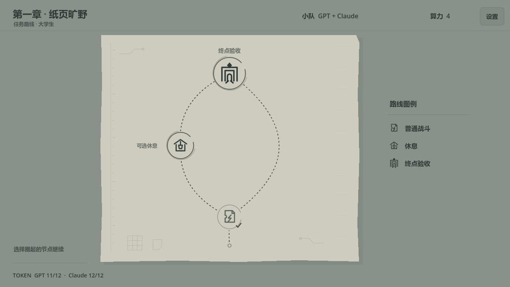
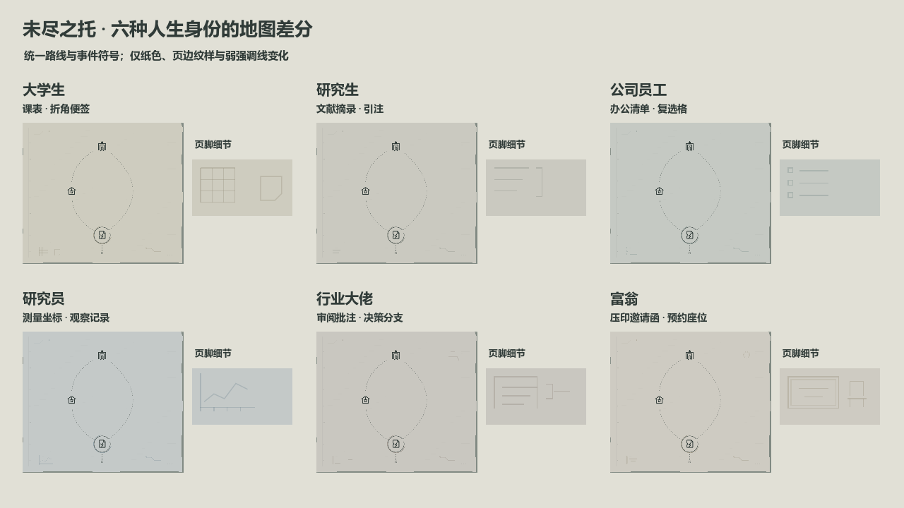
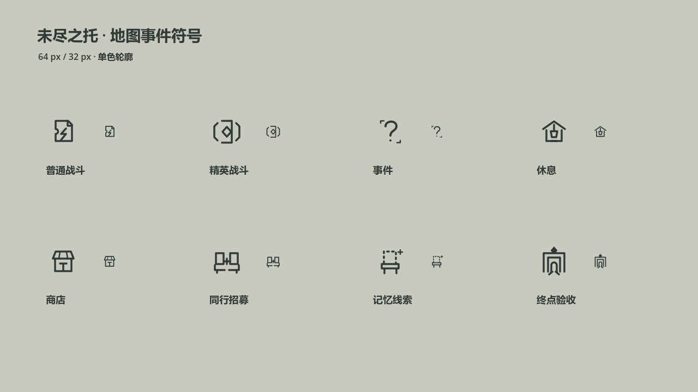

# 《未尽之托》地图路线与事件符号 v2

日期：2026-10-27。状态：已接入 Godot 主流程。

本日更正：用户所说的角色差分指玩家人生身份（大学生、研究员等），不是 GPT、Claude、DeepSeek 等 AI 队友。以下为更正后的现行口径。

## 视觉方向

按本轮用户提供的《杀戮尖塔》地图截图，采用低饱和纸面、向上分叉的细虚线、小型单色事件符号和简短侧边图例。保留本作的文档、任务缺口、同行座位、离散记忆和终点验收门元素。

地图由 `game/scripts/map_route_canvas.gd` 绘制，背景不是生成位图。纸面、路径、可选圈与页边图形可以共用同一套逻辑；八张图标是 `game/assets/map_icons/route_v2/` 中的独立透明 SVG。旧地图原画与 v1 PNG 保留，当前地图不加载它们。

## 背景与玩家身份差分

- 基础底色：低饱和灰绿 `#89918A`；纸面接近 `#C9CABE`；图标和正文统一墨灰 `#303B38`。
- 科幻元素收在页边：极细注册刻度、两段终端连线、少量点阵。纹理不进入主要节点区，不使用泛光或闪烁。
- 差分只影响纸色、手绘圈的第二道线与页脚的生活/工作物件纹样。地图只读取 `runState.stage`，不读取 AI 队伍决定主题，也不混合队友配色。
- 所有身份共用相同路线位置、图标与启用条件。渲染不调用随机数，也不写入战斗或存档状态。
- 编队页右上新增独立的“玩家身份”选择入口。换 AI 队友不重置身份，地图副标题显示本局身份；身份随存档恢复。旧存档缺少身份时默认为 `student`，不会根据 AI 队友推测。
- 六身份目前仅接入地图外观，研究员等扩展身份的剧情、任务池、专属遭遇仍属后续范围。身份不改变 token、AI 技能或钱包数值。

| 玩家身份 | 纸色 | 弱强调色 | 页脚纹样 | 实机 |
| --- | --- | --- | --- | --- |
| 大学生 `student` | `#CECCBF` | `#96907C` | 课表网格、折角便签 | [截图](../../_build/evidence/map_identity_v2_student.png) |
| 研究生 `graduate` | `#CAC9C0` | `#898D83` | 文献摘录、引注边线 | [截图](../../_build/evidence/map_identity_v2_graduate.png) |
| 公司员工 `employee` | `#C5C9C3` | `#7C8D89` | 办公清单、复选格 | [截图](../../_build/evidence/map_identity_v2_employee.png) |
| 研究员 `researcher` | `#C4C9C8` | `#7B8D96` | 测量坐标、观察记录 | [截图](../../_build/evidence/map_identity_v2_researcher.png) |
| 行业大佬 `expert` | `#C9C7C0` | `#91877D` | 审阅文件框、旁注括号；右上页边增加小型决策分支 | [截图](../../_build/evidence/map_identity_v2_expert.png) |
| 富翁 `wealthy` | `#CECBC2` | `#958D78` | 双线压印邀请函、预约座位；右上页边增加低对比圆形压印 | [截图](../../_build/evidence/map_identity_v2_wealthy.png) |

行业大佬的差分使用“审阅与决策”的工作材料，富翁使用“邀请与本人出席”的生活材料，六种身份共用同一低饱和与小面积装饰规则。两个新增页边图形均使用约 27% 不透明度、1px 线宽，放在实际路径以外；没有连到事件节点，也不响应点击。邀请函以哑光双线表示压印，纸面不增加金色泛光。

## 路线与节点

当前已实现的两战流程显示三个真实节点：底部普通战，中左侧可选休息，顶部 Boss 验收。普通战之后有两条细虚线：经过休息、直接到 Boss。两条线路对应已有玩法选择，没有增加战斗数量。

- 路径线宽约 `1.5 px`，短划约 `3.5 px`、节距 `9 px`，曲线在节点前留出空隙。
- 当前可进入节点：手绘式双线圈。已完成节点：单圈、小勾、图标略淡。未来不可进入节点：图标和路径变浅。
- 节点点击范围 `72 × 72 px`，普通符号放在约 `50 × 50 px` 的图像框中，Boss 使用约 `64 × 64 px` 的图像框。源图为透明 `64 × 64` SVG，可无损放大。
- 详细敌名、HP、恢复量只在悬停提示里显示。常驻图例只列当前已接入的普通战、休息和终点验收。
- 鼠标悬停使用浅底与细框；可用节点支持键盘焦点框。没有周期闪烁。

## 八类事件符号

所有图标使用同一墨灰、圆端线条，主笔画 `3.5 px / 64 px`。每张只保留一个核心符号，颜色不承担类型区分。

| ID | 含义 | 主要符号 | 接入情况 |
| --- | --- | --- | --- |
| `battle_ordinary` | 普通战斗 | 有缺口的任务页＋一笔断线 | 已接入 |
| `battle_elite` | 精英战斗 | 审核括号＋菱形封签 | 资产已备，待玩法接线 |
| `event_clue` | 事件 | 问号＋两段文档角标 | 资产已备，待玩法接线 |
| `rest` | 休息 | 纸棚＋一盏灯 | 已接入 |
| `shop_supply` | 商店 | 文件柜台＋简化棚顶 | 资产已备，待玩法接线 |
| `recruit` | 同行招募 | 双座位＋连接符 | 资产已备，待玩法接线 |
| `memory_clue` | 记忆线索 | 离散椅背＋小光点 | 资产已备，待玩法接线 |
| `boss_acceptance` | Boss 验收 | 双层验收门＋顶部菱形标记 | 已接入 |

## 验证与复现

- `game/tests/test_map_routes.gd`：六身份 × 经过/跳过休息，共十二条实际按钮流程；覆盖身份选择入口、换 AI 保留身份、普通战后节点启用、恢复一次结算、Boss 入场、设置返回标题后的身份恢复，以及地图重绘不改变游戏状态。另做六身份 × 四种 AI 编队，共二十四次地图主题独立性检查；旧存档恢复校验默认大学生。
- `game/tests/test_save_manager.gd`：身份保存/恢复、无身份的旧存档兼容、非法身份拒绝；身份字段为可选扩展，不变更 schemaVersion。
- `game/tests/capture_map_routes.gd`：生成六身份、同一研究员身份配三名不同 AI、身份选择入口、双人、普通战后、休息后、设置和八符号对照图。需要有渲染能力的运行环境；所有存档使用 `_build/test_saves/` 中的专用文件。
- `game/tests/capture_life_stage_comparison.gd`：共用正式地图绘制器生成六身份对照图，并将各身份页脚纹样单独放大展示，输出 `map_identity_v2_all_comparison.png`。放大框只用于设计评审，不进入游戏界面。
- 已有 `test_ui_flows.gd`、`test_ui_clicks.gd` 继续覆盖单/双/三人流程与 12 轮按钮/拖拽切换。地图测试已加入 `_build/run_stage2_tests.ps1`。
- 现有三节点固定路线仍是实现范围；后续多战、多层随机分支和事件玩法须按对应数据轮接入，不在背景美术改动中扩充。

现行身份差分证据：`_build/evidence/map_identity_v2_*.png`。早期 `map_route_v2_gpt/claude/deepseek.png` 为误解需求时的旧稿，只保留追溯用途。当前 Windows 构建仍使用 `dist/windows/LeftInTrust.exe`。

身份更正后的验证：十二条身份/分支流程、二十四次 AI 编队独立性检查通过，存档测试 9/9；全量回归摘要见 `_build/evidence/test-logs/stage2-tests-summary.log`，地图流程日志为 `map-route-tests.log`。

本次全量门禁 11 组均通过。实机截图对同一研究员身份、GPT/Claude/DeepSeek 三种 AI 队友进行地图区域像素抽样比对，差异均为 0。`map_identity_v2_selection.png` 展示新增的玩家身份入口；六种身份与对应页边元素已逐张检查。Windows 程序已重新导出，打包版研究员地图证据为 `map_identity_v2_exe.png`，其专用存档使用 `_build/test_saves/map_identity_v2_exe.json`。

本日补充行业大佬与富翁细节后，`test_map_routes.gd` 再次通过十二条身份/分支流程与二十四次编队独立性检查；本轮日志为 `_build/evidence/map_identity_all_routes.log`。六身份对照图与正式地图分别渲染检查，Windows 版同步更新。
